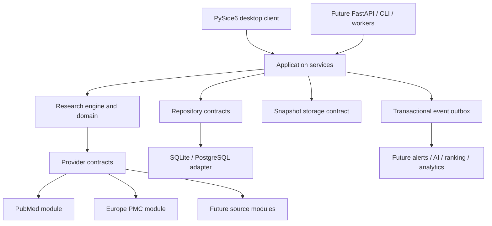

# Architecture

## Google Sheets projection

The shared application layer projects one research project's exported paper fields
to a dedicated tab in a user-selected Sheet. A Google Sheets adapter implements
the remote read/write port; the database keeps only a project-to-Sheet link and
sync status. A manual browser action can request sync, and successful/partial
scheduled runs invoke it after ingestion. Sync is idempotent by canonical paper
ID and writes a last-successful-update marker only after all rows are written.
Credentials are supplied as a local service-account file; no credential or
private key is stored in the database or exposed to the browser.

## Shared Boolean query planning

`domain/search_expression.py` defines the portable AST, parser, precedence and
metadata evaluation. Saved-query application workflows validate expressions; each
provider renders that AST into its own syntax. `QueryPreviewService` presents
normalized syntax and provider plans without network I/O; both browser and future
clients can use it through the neutral composition root.

Crossref evaluates Boolean/quoted expressions against metadata from ranked candidate
pages. Its adapter owns branch/cursor encoding and retains every raw page, including
pages with zero accepted records. The existing ingestion, identity, audit, outbox,
retry and monitoring services remain the persistence path. Provider translation
versions invalidate incompatible continuation plans. No schema extension is needed.
See [query semantics](BOOLEAN_SEARCH.md).

## Optional local web adapter

`web/` is a FastAPI + packaged HTML/JS client over the UI-neutral composition root.
Projects, saved queries, papers, search history and coverage are accessed through
existing application services, never direct ORM queries or desktop controllers.
`ApplicationServices.search_service(allowed_sources=...)` optionally applies the
workflow source policy without duplicating ingestion. Search and scheduled workflows
run in background threads with worker-owned provider event loops. Lifespan owns
composition, optional polling and shutdown. Transport job state is bounded/ephemeral;
the existing execution audit is the durable record. One loopback-only server process
is supported; multi-user authentication/distributed scheduling remain future work.
See [web client operations](WEB_CLIENT.md). No schema change is required.

The desktop now presents revision/run/attempt history, query archive/restore,
status/read/tag filters, stopped-worker recovery and explicit identity review.
Search, retry and export work stays in background workers. Progress is source
status plus an indeterminate busy indicator, not a claimed page percentage.
The shared application link policy opens only HTTP(S) publication URLs or safe
identifier-derived links; source metadata cannot launch local files/custom schemes.

IdentityReviewService is UI-independent and exposed by the neutral composition
root. Exact conflicts and conservative possible-duplicate flags are separate
workflows. Explicit source decisions are evidence-signature-bound and affect
subsequent ingestion only; no historical merge, identifier transfer or source
reparenting occurs. Domain normalization builds signatures/candidate keys; the
repository validates ownership and commits decisions with audit events atomically.

Metadata normalization preserves provider-specific publication taxonomies and
explicit statuses. The canonical view selects URL/types/status with evidence;
source snapshots retain all normalized assertions. Citation metrics are separate
time-stamped observations by provider, not a canonical summed count. Export and
detail read models expose these facts without UI coupling.

The UI-neutral composition root is `infrastructure/bootstrap.py`; the desktop
bootstrap is a compatibility adapter only. CLI/worker composition does not import
PySide6. RecoveryService exposes stopped-worker recovery, coverage restart and
queued scheduled retry through a repository port. Manual retry uses compatible
saved cursors and new audited runs, never mutation of the original run.

## Monitoring gap remediation

Migration `0006_monitoring_coverage` adds revision/signature-bound coverage
campaigns and starting-cursor traceability. Scheduled searches continue committed
pages in a full reconciliation lane and an independent overlapping recent-date
lane. Frozen window bounds survive retries; exhausted full campaigns restart to
catch late indexing and older updates. Partial coverage is a separate scheduled
state. Cursor loops are rejected across attempts, and progress advances in the
same transaction as observations/outbox. See [gap remediation](GAP_REMEDIATION.md).

## 0.1.3 source and settings extension

See [Source/settings design](SOURCE_SETTINGS_DESIGN.md) for the reviewed contract
and [Settings guide](SETTINGS.md) for user-facing behavior. Four isolated literature
providers (PubMed, Europe PMC, OpenAlex, Crossref) share the existing audited
ingestion port. A source catalog supplies presentation metadata without UI
source-name conditionals. Application settings validate workflow defaults via a
persistence port; only the composition root builds HTTP/provider instances.
Source batches run in the application layer, not widgets. Manual and scheduled
sessions apply the same proxy/access configuration and page budgets. Monitoring
uses a separate source allow-list, attempts all eligible query sources and records
aggregate failure without hiding successful runs. No event consumer is required.
The SQL adapter accepts injectable source priorities to avoid arrival-order
metadata oscillation, keeping the reusable engine independent of that policy.

## Approved direction

The system is a **modular monolith** with a reusable Python research engine. PySide6 is a desktop client only. Domain and application behavior must not depend on the GUI, an HTTP framework, a particular provider, or SQLAlchemy models. Provider modules implement a stable interface, allowing new sources to be registered without changing core domain rules.

## Component responsibilities

| Component | Owns |
| --- | --- |
| Desktop client | User interaction, display state, and background invocation of application services. It does not implement search, merge, or persistence rules. |
| Application services | Search runs, project workflows, transactions, scheduling coordination, exports, and event publication. |
| Research engine | Source-independent query intent, normalized publication models, identity matching, merge policy, review rules, and discovery decisions. |
| Provider contracts | Search, pagination, retrieval, query translation, and normalization expectations. Modules declare supported filters and capabilities. |
| Provider modules | HTTP behavior, authentication, rate limiting, source syntax, parsing, and source-specific identifiers. PubMed and Europe PMC are initial discovery modules. |
| Repository adapter | Storage and retrieval of canonical records, projects, queries, provenance, run state, and outbox entries. |
| Snapshot adapter | Immutable compressed raw responses or equivalent source snapshots, with content hashes and database references. Local files initially; object storage can be added later. |
| Export adapters | Versioned CSV and RIS output from selected project results and their provenance. |
| Monitoring service and local host | Durable due-work claims and attempt status in the application layer; a local thread polls while the desktop is open. A future server worker can host the same service. |

The code lives under `src/research_engine/`: `domain/` holds pure values and identity/classification policy, `ports/` holds provider and storage interfaces, `application/` orchestrates discovery and ingestion, and `infrastructure/` holds SQLAlchemy and provider adapters plus local snapshot storage. The domain and application packages do not import SQLAlchemy or an HTTP library.

### Stage 2 provider contract refinement (approved architecture, before implementation)

One PubMed search page requires both an ESearch response (IDs and total hits) and an EFetch response (article metadata). A single `SearchPage.raw_response` cannot preserve both. Search pages therefore carry an ordered, nonempty `raw_responses` tuple; each normalized record identifies the response index that supplied its metadata. `SearchPage.total_count` records the source-reported hit count when available, so pagination limits can be surfaced rather than mistaken for completion. `ProviderRecord.source_database` distinguishes, for example, Europe PMC's `MED` and `PPR` record families under one provider; `source_id` remains unique within that provider. Existing `ProviderQueryPlan` and its unsupported-filter disclosure remain the query-translation boundary. The application rejects unsupported filters rather than silently broadening results.

`DiscoveryService` plans and executes bounded in-memory page runs for one registered provider, rejects unsupported filters, and rejects stalled cursors. PubMed's ESearch plus EFetch responses are both retained; Europe PMC's core search response is retained. The shared HTTP adapter paces requests per provider instance, applies bounded transient retries and shared `Retry-After` cooldowns, and never puts credentials into snapshot request metadata. Stage 3's separate `IngestionService` adds durable ingestion without making provider modules write to the database.

Stage 3 adds an explicit provider `parser_version`, separate from query `translation_version`. The former records which normalizer produced each stored source record and snapshot; the latter describes how search intent became a provider query. An application ingestion service coordinates providers, immutable byte storage, and a transactional repository port. It writes each completed page's database metadata and outbox events in one transaction, then advances the run cursor. A failed later page retains previously committed pages and marks the run failed for audit or retry. The provider and domain packages remain database-independent.

Stage 4 adds a UI-independent project workflow application service behind a persistence port. It creates/archives projects, manages versioned saved queries, attaches shared canonical papers to projects, and updates project-scoped tags and review state. A visible four-state review status is derived from two orthogonal facts: reading (`read_at`) and decision (`none`/`important`/`excluded`). Filtering by read state does not erase an important or excluded decision. Ingestion attaches a paper to the owning project when a saved query matches it, but never copies the canonical article. New runs bind to an immutable portable-query revision in addition to the provider-specific query plan; old runs with no revision link remain auditable from their existing plan and snapshots.

### Stage 5 client boundary (documented before UI implementation)

The existing `ProjectService` supports project/query CRUD, paper listing, review, and tags. Stage 5 adds a read-only `PaperDetail` projection and provider-neutral `ManualSearchService` entry point to the application/port boundary so future FastAPI endpoints can call the same services. A composition root constructs SQLAlchemy and provider adapters outside views; PySide6 views/controllers use application services and read models, never ORM tables or provider HTTP clients. A search worker owns its own asynchronous provider lifecycle and reports results/errors through Qt signals, so network and ingestion do not block the UI thread. “Delete project” means confirmed soft deletion via archive, preserving search and review audit history. No schema change was needed for the desktop itself. Local database reads and edits remain synchronous; large-collection pagination/background loading is future work.

### Stage 6 monitoring and export decision (before implementation)

Export is an application service that reads project-scoped canonical paper details and produces CSV or RIS bytes; PySide6 only chooses a destination and saves the resulting document. Excluded papers are included by default so export does not silently discard review work. RIS uses bibliographic tags for bibliographic fields and notes for project-specific review metadata. The export service is reusable by a future HTTP endpoint.

CSV output uses UTF-8, explicit column headers, and spreadsheet-formula escaping for untrusted text. RIS uses standard tagged lines, including `AN` for the PMID accession number and `N1` notes for project/review/tag context, following the [EndNote Reference Manager (RIS) export convention](https://endnote.com/downloads/styles/reference-manager-ris-export/). RIS values are normalized to one line so source text cannot inject new tags.

Schedules and scheduled-execution attempts are durable database records behind an application port. A local background runner polls due schedules while the desktop is open, claims work transactionally, runs enabled providers via the existing ingestion service, and records completion or failure with linked search-run IDs. A database partial unique index allows at most one running scheduled execution per query; claiming advances the next due time, avoiding an immediate catch-up loop. The runner is local-only in v1, but the application scheduler has no Qt dependency and can later run in a server worker. Crash recovery and distributed lease renewal are deferred; an interrupted running attempt requires explicit recovery before that query schedules again. Manual searches use the existing ingestion path but are not included in the scheduled-attempt overlap guard.

The outbox remains recording-only in Stage 6. Neither export nor the scheduler needs an event consumer: export reads committed records, and scheduled execution state is written directly. Notification or analytics consumers remain future extensions.

### Provider network configuration

An application-level `NetworkSettingsService` exposes a UI-neutral opt-in proxy setting behind a persistence port. The desktop stores it atomically in a local JSON file; widgets only edit the setting. Manual and scheduled provider factories read the current setting when creating new clients and pass it to the shared paced HTTP transport. Both PubMed and Europe PMC therefore use the same explicit route for search and fetch operations. Direct mode disables environment-proxy inheritance for app-owned HTTP clients. No proxy URL is copied into query plans, source snapshots, or application logs. Credential-bearing proxy URLs are rejected in this local-settings version.

### Stage 7 release hardening

Wheel installs include Alembic configuration and migration revisions as package data, so desktop startup can migrate from either a source checkout or an installed wheel. Recovery of an interrupted scheduled execution remains an explicit operator action: only after confirming its worker has stopped, the operator marks the attempt and any linked still-running provider runs failed in one transaction. Application logs record run/attempt identifiers, states, and exception type names, not raw provider exception text or credential-bearing request URLs. No outbox consumer is introduced.

## Discovery data flow

1. A saved query belongs to a Research Project and expresses user intent and filters.
2. Each enabled provider translates the supported parts of that query. The run records any unsupported clause or filter rather than silently weakening the search.
3. A provider fetches pages with its own rate policy. The raw response is saved before normalization, excluding secrets from request metadata and stored query-plan parameters.
4. The engine normalizes candidates and matches exact identifiers first. Conflicting exact IDs become unresolved conflict records; title-only similarity does not merge or create a review candidate yet.
5. The application stores or updates canonical paper metadata, source provenance, query matches, and idempotent links to the saved query's owning project.
6. The same page transaction writes discovery or update events to an outbox. Consumers can later process them idempotently.
7. The run records cursors, counts, failures, and timestamps. Automatic overlapping-window scheduling and reconciliation are future work.

Publication date, source entry date, source update date, and first discovery time are distinct. A repeat search should not duplicate a paper or a project match. Preprints, published versions, corrections, and retractions remain distinct linked records.

The initial schema retains each provider query plan and lets a search run reference the exact plan used. Composite keys prevent a run from claiming another query's or provider's plan, and prevent source records from claiming another provider's snapshots. Source records link to every raw snapshot that contained them, even when their latest snapshot pointer changes. Project paper reading (`read_at`) is independent of its review decision (`none`, `important`, or `excluded`). Projects and queries have archive timestamps so ordinary removal can preserve their audit history.

## Event design

Stage 3 writes `PaperDiscovered` and `PaperMetadataUpdated` in the same page transaction as article and observation changes. Stage 4 writes `PaperAddedToProject` for manual attachments and `ReviewStatusChanged` for review transitions in the same transaction as those changes. Automatic query-match attachments are stored transactionally but do not emit a separate project event. V1 does not require a message broker or user-facing event consumers. Events have IDs, schema versions, occurrence times, aggregate IDs, and context for idempotent processing. Later notification and analysis workers can consume them without rewriting discovery.

## Evolution path

- **Local desktop:** PySide6 invokes the application services; SQLite and local snapshot files are suitable for one installation.
- **Shared server:** FastAPI and scheduled workers invoke the same services. PostgreSQL and shared snapshot storage replace the local adapters; authentication and authorization are added at this boundary.
- **Web and mobile:** Clients call the server API. Business rules remain in the application and engine packages.

Continuous monitoring requires an always-running worker or server. The v1 desktop starts a local monitoring thread that runs only while the application is open. Its default interval is daily when enabled, configurable per query; this is a practical v1 assumption pending deployment confirmation.
